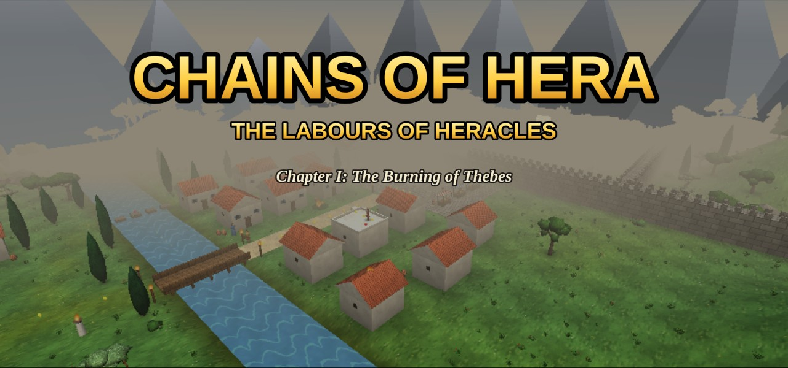
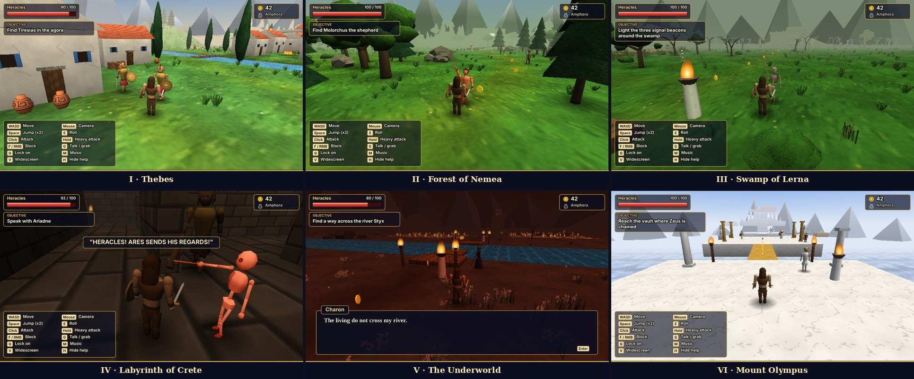
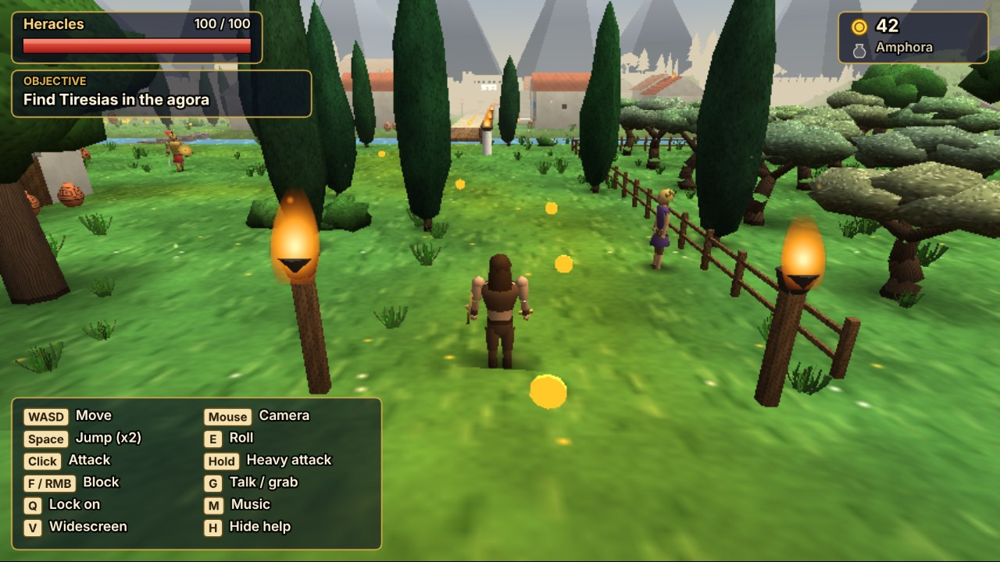
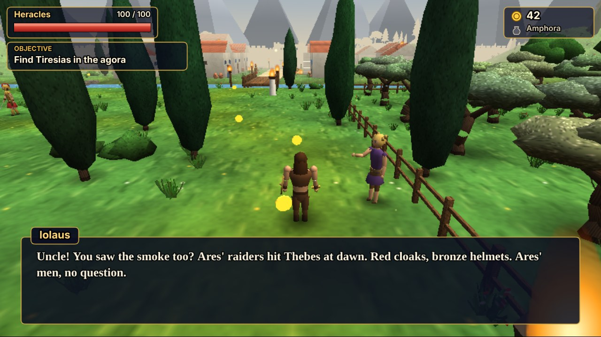
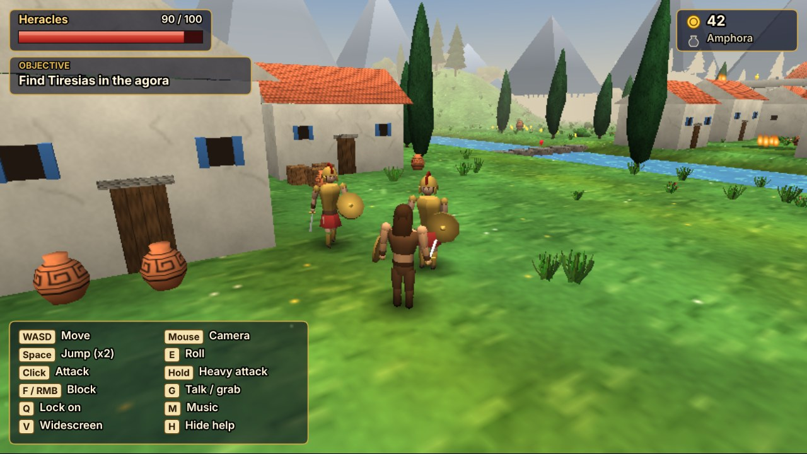
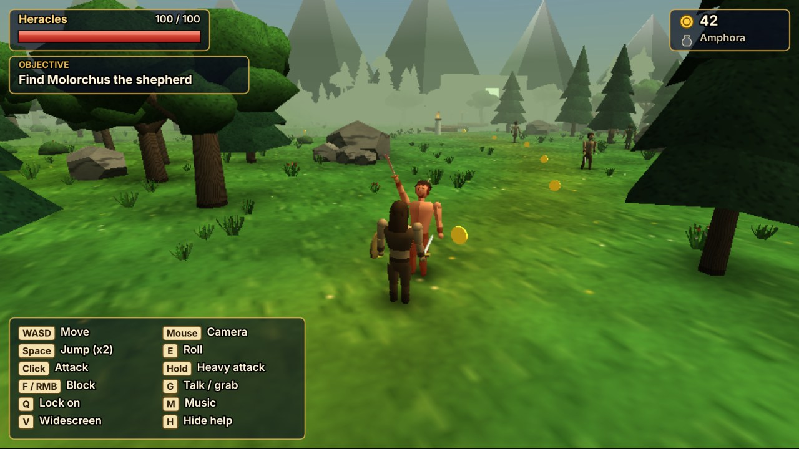
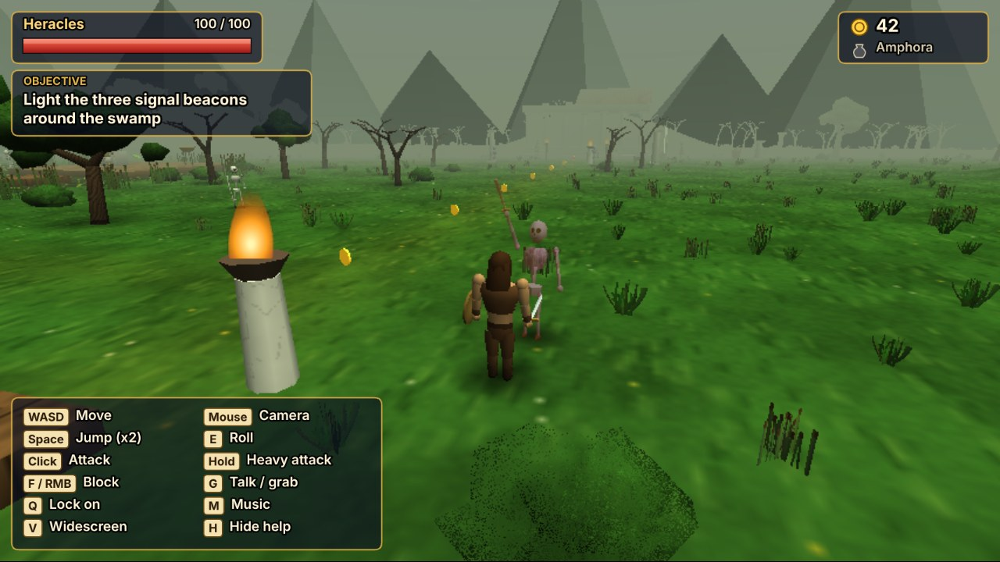
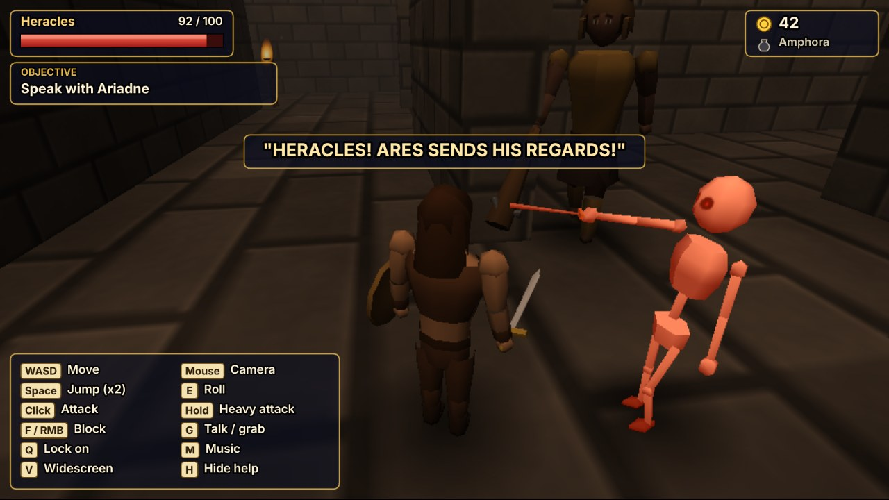
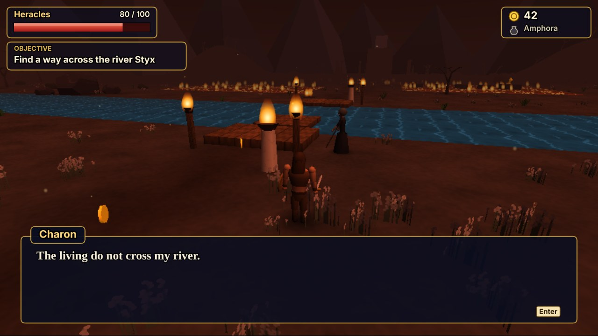
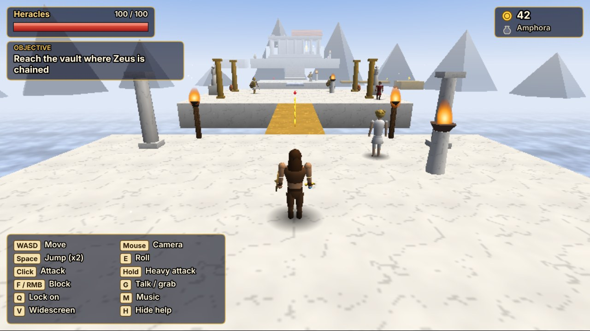

<div align="center">



# ⚡ Chains of Hera
### *The Labours of Heracles*

**A low-poly, N64-style 3D action-adventure that runs entirely in your browser.**
Free Zeus from his chains across six chapters, from burning Thebes to the peak of Olympus.

[](#-disclaimers)
[](#-disclaimers)
[](https://threejs.org/)
[](https://thebenn.me/Chains-of-Hera/)
[](https://github.com/BMKoscak/Chains-of-Hera/issues/new/choose)

### [▶️ **PLAY ONLINE IN YOUR BROWSER**](https://thebenn.me/Chains-of-Hera/)

<sub>No install needed. Click the link, then click the game and press <kbd>Enter</kbd>. Use <kbd>F11</kbd> for fullscreen.</sub>

[**Getting started**](#-getting-started) · [**Controls**](#-controls) · [**Chapters**](#-the-six-chapters) · [**Disclaimers**](#-disclaimers) · [**Report a bug**](https://github.com/BMKoscak/Chains-of-Hera/issues/new/choose)

</div>

---

> [!IMPORTANT]
> **This is an early demo.** It was **made with AI**, it can **change or break at any time**, and **bug reports and reviews are very welcome**. See the [disclaimers](#-disclaimers) for the details.
>
> 🎮 **[Play it online right now](https://thebenn.me/Chains-of-Hera/)**

## 📖 Table of contents

- [About the game](#-about-the-game)
- [Screenshots](#-screenshots)
- [Features](#-features)
- [The six chapters](#-the-six-chapters)
- [Getting started](#-getting-started)
- [Controls](#-controls)
- [Under the hood](#-under-the-hood)
- [Voice-over](#-voice-over)
- [Disclaimers](#-disclaimers)
- [Bugs, feedback and reviews](#-bugs-feedback-and-reviews)
- [Credits](#-credits)
- [License](#-license)

## 📜 About the game

> *When the gods quarrel, it is mortals who bleed.*

Zeus, king of Olympus, has fallen silent. His queen **Hera** and his son **Ares**, god of war, have bound him in chains that no god can break. With the Thunderer gone, Ares' raiders burn their way across Greece and Hera wakes monsters that have slept since the world was young.

Only one hero is half mortal and half god, and Hera has hated him since the day he was born. His name is **Heracles**.

Play through six chapters of third-person action: fight, roll, block and jump your way across the country, talk to the (fully voiced) people you meet, light beacons, cross rivers of the dead and finally break the last link of Hera's chain.

## 📸 Screenshots

<div align="center">

</div>

<table>
  <tr>
    <td width="50%"><br><sub><b>Exploration.</b> Torches, cypress trees and trails of drachmas lead the way through Thebes.</sub></td>
    <td width="50%"><br><sub><b>Voiced dialogue.</b> Iolaus brings news of the raiders at the gates of Thebes.</sub></td>
  </tr>
  <tr>
    <td width="50%"><br><sub><b>Combat.</b> Shield-bearing raiders of Ares hold the streets of Thebes.</sub></td>
    <td width="50%"><br><sub><b>The Forest of Nemea.</b> Pine and oak woods full of brigands and satyrs.</sub></td>
  </tr>
  <tr>
    <td width="50%"><br><sub><b>The Swamp of Lerna.</b> Light the signal beacons while the risen dead close in.</sub></td>
    <td width="50%"><br><sub><b>The Labyrinth of Crete.</b> Dark corridors, taunting enemies and Ariadne's thread.</sub></td>
  </tr>
  <tr>
    <td width="50%"><br><sub><b>The Underworld.</b> The ferryman Charon guards the way across the Styx.</sub></td>
    <td width="50%"><br><sub><b>Mount Olympus.</b> A sea of cloud, gold roads and the vault where Zeus is chained.</sub></td>
  </tr>
</table>

<sub>Screenshots were captured from the game itself in widescreen mode (<kbd>V</kbd>). The in-game help panel (top-left, <kbd>H</kbd> hides it) is visible in most of them.</sub>

## ✨ Features

- 🎮 **Six chapters** with their own look, music, enemies and objectives.
- ⚔️ **Third-person combat**: light and heavy attacks, blocking, rolling, double jump and a lock-on camera.
- 🗣️ **Voiced story**: narrator, chapter intros, an ending and a cast of NPCs, all with AI-generated voice-over.
- 🎵 **Adaptive music**: a procedural score that shifts between explore, combat and danger layers.
- 🏺 **Things to find**: hidden amphorae, drachmas, secret glades with urn caches and coin trails, smashable urns, rocks, stalls and toppling statues.
- 🛡️ **Gear and power-ups**: the Bronze Sword of Zeus, a Bronze Shield, the Golden Sword of Daedalus (+50% damage) and olive wreaths (+25 max health).
- 🧭 **Level design with variety**: checkpoints, hazards, boulders to carry, beacons to light and a ferry to pay for.
- 💾 **Chapter select and saves**: progress is stored in your browser, and unlocked chapters can be replayed from the title screen.
- 🕹️ **Keyboard and mouse, or gamepad** (standard Xbox-style layout).
- 🖥️ **Retro presentation**: renders at 640×480 (4:3) or 854×480 (widescreen) and scales up for that chunky N64 look.
- 📦 **No build step and no engine install**: one HTML file, one script from a CDN and some MP3s.

## 🧭 The six chapters

| # | Chapter | Setting | First objective |
|:-:|---|---|---|
| I | **The Burning of Thebes** | A town under siege by Ares' raiders | Find Tiresias in the agora |
| II | **The Forest of Nemea** | Dense woods where a golden-hided lion hunts | Find Molorchus the shepherd |
| III | **The Swamp of Lerna** | Fog, bog and a sealed lair of the Hydra | Light the three signal beacons around the swamp |
| IV | **The Labyrinth of Crete** | Torch-lit corridors, bull guards and shades | Speak with Ariadne |
| V | **The Underworld** | Ash fields, the river Styx and the Stair of Souls | Find a way across the river Styx |
| VI | **Mount Olympus** | Marble gardens above a sea of cloud | Reach the vault where Zeus is chained |

Beat a chapter to unlock the next one. Once more than one chapter is unlocked, the title screen lets you pick which one to play with <kbd>←</kbd> / <kbd>→</kbd>.

## 🚀 Getting started

### ▶️ Play online (easiest)

**[Play Chains of Hera in your browser](https://thebenn.me/Chains-of-Hera/)** — it is hosted with GitHub Pages, so there is nothing to download or install.

- Use a desktop **Chromium-based browser** (Chrome or Edge recommended) with WebGL. Other browsers are untested.
- **Click the game** so it can capture your mouse, then press <kbd>Enter</kbd> to begin. Press <kbd>F11</kbd> for fullscreen.
- Your progress is saved in your browser for that site, so use the same browser to continue later.
- The online version always follows the latest commit, so it can change at any time (see the [disclaimers](#-disclaimers)).

### 💻 Run it locally

Prefer to play offline or tinker with the code? Run it on your own machine.

#### Requirements

- A modern **Chromium-based browser** (Chrome or Edge recommended) with WebGL. Other browsers are untested.
- **[Node.js](https://nodejs.org)** (20.6 or newer recommended) to run the tiny local server.
- An **internet connection** the first time you play: [Three.js r128](https://cdnjs.com/libraries/three.js/r128) is loaded from the cdnjs CDN.

#### Download

```bash
git clone https://github.com/BMKoscak/Chains-of-Hera.git
cd Chains-of-Hera
```

…or use **Code → Download ZIP** on this page and unzip it.

#### Windows (double-click launcher)

Double-click **`Play Chains of Hera.bat`**. It starts a local server and opens the game fullscreen in Chrome or Edge in its own browser profile. Close the console window to stop the server, and press <kbd>F11</kbd> to leave fullscreen.

#### macOS / Linux

The launcher script only knows how to open Chrome or Edge on Windows, so tell it not to try and open the page yourself:

```bash
HERA_NO_BROWSER=1 node scripts/serve.mjs
# then open http://localhost:8137/index_7_1.html
```

#### Any other static server

The game is just static files, so any web server works as long as it serves this folder:

```bash
python3 -m http.server 8137
# then open http://localhost:8137/index_7_1.html
```

#### First steps

1. **Click the game** so it can capture your mouse (this controls the camera).
2. Press <kbd>Enter</kbd> or click to begin and let the narrator set the scene.
3. Follow the **objective** shown at the top-left of the screen.

> [!TIP]
> Saves live in your browser's local storage **per address**. If you switch between `localhost:8137`, another port or the launcher's own browser profile, you will see separate saves.

## 🎮 Controls

### Keyboard and mouse

| Action | Control |
|---|---|
| Move | <kbd>W</kbd> <kbd>A</kbd> <kbd>S</kbd> <kbd>D</kbd> |
| Walk (slower) | Hold left <kbd>Shift</kbd> |
| Camera | Mouse (or the arrow keys) |
| Jump / double jump | <kbd>Space</kbd> |
| Roll | <kbd>E</kbd> |
| Attack | Left click (or <kbd>J</kbd>) |
| Heavy attack | Hold the attack button |
| Block | <kbd>F</kbd> or right click |
| Talk / grab / light beacons | <kbd>G</kbd> |
| Lock on to a target | <kbd>Q</kbd> or <kbd>Tab</kbd> |
| Continue / confirm | <kbd>Enter</kbd> (also <kbd>Space</kbd> or a click in dialogue) |
| Toggle widescreen | <kbd>V</kbd> |
| Toggle music | <kbd>M</kbd> |
| Show / hide the help panel | <kbd>H</kbd> |

### Gamepad (standard layout)

| Action | Button |
|---|---|
| Move / camera | Left stick / right stick |
| Jump, confirm | <kbd>A</kbd> |
| Roll | <kbd>B</kbd> |
| Attack | <kbd>X</kbd> |
| Talk / grab | <kbd>Y</kbd> |
| Lock on | <kbd>LB</kbd> or <kbd>LT</kbd> |
| Block | <kbd>RB</kbd> or <kbd>RT</kbd> |
| Widescreen / help panel | <kbd>Back</kbd> / <kbd>Start</kbd> |
| Choose chapter (title screen) | D-pad left / right |

## 🔧 Under the hood

Everything lives in a single file, [`index_7_1.html`](index_7_1.html). Models, textures, music and sound effects are all **generated in code at runtime**, so the game ships with no image or audio assets other than the voice-over.

<details>
<summary><b>Architecture overview</b></summary>

| Module | Responsibility |
|---|---|
| `Util` | Math helpers and a seeded random number generator |
| `Tex` | Runtime-painted 64×64 tileable textures and sprites |
| `Input` | Keyboard, mouse (pointer lock) and Gamepad API with input latches |
| `World` | Data-driven level building, static batching and ground queries |
| `Player` | Fixed-step Heracles character (about 880 triangles) |
| `Enemies`, `Props`, `Pick`, `Proj`, `Breakables` | Combat world, interactables, pickups, projectiles, smashable props |
| `Level` | Checkpoints, hazards, beacons and the chapter goal |
| `Audio` | Web Audio score with explore / combat / danger layers, plus sound effects |
| `FX`, `Sky` | Particles, trails and rings, plus gradient dome, sun and clouds |
| `NPC`, `Story`, `Voice` | Villagers, dialogue, chapter cards, objectives and voice-over playback |
| `Cam` | Third-person follow camera with lock-on and collision |
| `HUD` | Canvas overlay for health, objectives, dialogue and help |
| Loop | 60 Hz fixed-step logic with interpolated rendering at 640×480 or 854×480 |

</details>

<details>
<summary><b>Project structure</b></summary>

```text
Chains-of-Hera/
├── index_7_1.html            # The whole game: engine, levels, story, audio and HUD
├── Play Chains of Hera.bat   # Windows double-click launcher
├── scripts/
│   ├── serve.mjs             # Tiny static server that can open the game fullscreen
│   └── generate-voices.mjs   # Generates the voice-over with ElevenLabs
├── voices/                   # AI voice-over MP3s, one folder per chapter
│   ├── manifest.json         # Text and hash for every line (used to skip unchanged lines)
│   ├── village/ forest/ lerna/ labyrinth/ underworld/ olympus/
│   └── ending_0.mp3 … ending_3.mp3
├── docs/screenshots/         # Images used in this README
├── .github/ISSUE_TEMPLATE/   # Bug report and feedback forms
└── package.json              # Only needed for regenerating the voice-over
```

</details>

<details>
<summary><b>Developer notes</b></summary>

- Add `#proving` to the URL (`http://localhost:8137/index_7_1.html#proving`) to load the **Proving Ground**, a small test level with platforms, moving platforms and a handful of enemies.
- <kbd>`</kbd> (backquote) or <kbd>F3</kbd> toggles a debug overlay.
- The local server refuses to serve `.env*`, `.git` and `node_modules`.

</details>

## 🎤 Voice-over

All spoken lines (the narrator and every NPC) are **AI-generated speech** made with [ElevenLabs](https://elevenlabs.io/) text-to-speech and stored in [`voices/`](voices). There are no human voice actors. If a voice file is missing, the game simply skips it, so the dialogue box still works with text only.

You do **not** need an API key to play. To regenerate the voice-over after editing the script lines you need your own ElevenLabs account:

```bash
npm install
# create a file named .env.local containing:  ELEVENLABS_API_KEY=your_key_here
npm run voices            # only regenerates lines whose text changed
npm run voices -- --force # regenerates everything
```

`.env.local` is listed in `.gitignore` so your key is never committed.

## 🚨 Disclaimers

> [!WARNING]
> **Demo version.** Chains of Hera is an early, unfinished demo. It can be **updated, changed or broken at any time and without notice**: levels, balance, controls, story text and voice-over may change, features may be added or removed, and **save data may stop working or be reset** between versions. The online version is redeployed whenever the repository changes.

> [!NOTE]
> **Made with AI.** The game was created with the help of AI: the code was written with AI assistance (Anthropic's Claude) under the direction of the author, and all voice-over is AI-generated speech. Expect rough edges, and please remember that AI-written code can contain bugs.

- **Bugs are expected.** You may run into crashes, glitches, odd collisions, difficulty spikes or performance problems on some devices and browsers.
- **Provided as is.** The game is offered without warranty of any kind.
- **Independent fan project.** It is inspired by the myths of ancient Greece and by classic 3D action-adventures. It is **not affiliated with, sponsored by or endorsed by** any film, television or video game franchise, studio or rights holder.
- **Mythology, not history.** The story is a loose, playful retelling of Greek myth.
- **Privacy.** The game runs in your browser, has no accounts, no analytics and no tracking. The only thing it stores is your save in your browser's local storage, and the only request it makes to another server is loading Three.js from cdnjs (the online version is hosted on GitHub Pages).
- **Performance.** The game uses WebGL. Older or very low-power devices may run it slowly.

## 🐛 Bugs, feedback and reviews

Your feedback is exactly what this demo needs. 🙏

- 🐞 **Found a bug?** [Open a bug report](https://github.com/BMKoscak/Chains-of-Hera/issues/new?template=bug_report.yml)
- 💬 **Want to share a review or an idea?** [Send feedback](https://github.com/BMKoscak/Chains-of-Hera/issues/new?template=feedback.yml)
- ⭐ **Enjoyed it?** A star on the repository helps others find the game.

A good bug report includes:

1. Which **chapter** and roughly where you were.
2. **What happened** and what you expected to happen.
3. **Steps to reproduce** it, if you can.
4. Your **browser, operating system** and whether you used keyboard or gamepad.
5. A **screenshot** or a note from the browser console (<kbd>F12</kbd>), if there is one.

## 🙌 Credits

- **Game design and direction:** [BMKoscak](https://github.com/BMKoscak)
- **Code:** written with AI assistance (Anthropic's Claude)
- **Voice-over:** [ElevenLabs](https://elevenlabs.io/) text-to-speech
- **3D engine:** [Three.js](https://threejs.org/) r128 (MIT licensed), loaded from [cdnjs](https://cdnjs.com/)
- **Inspiration:** the myths of ancient Greece

## 📄 License

No license file has been added to this project yet, so by default **all rights are reserved by the author** (the `ISC` entry in `package.json` is just npm's default placeholder). You are welcome to play the game and share feedback. If you would like to reuse any part of it, please [open an issue](https://github.com/BMKoscak/Chains-of-Hera/issues/new/choose) and ask first.

---

<div align="center">
<sub>Made with ⚡ and a lot of AI. Thanks for playing!</sub>
</div>
